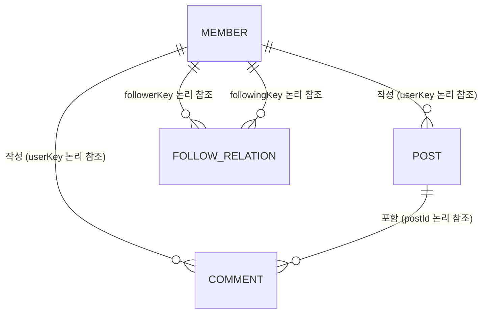
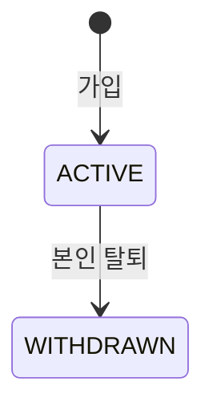

# Pet Feed 도메인 명세서

- 작성일: 2026-10-27 / 최종 갱신: 2026-10-30 (Asia/Seoul)
- 기준: 로컬 `feature/temporary-ui`의 현재 구현. main 병합 여부와는 별개다.
- 목적: 구현된 모델, 관계, 업무 규칙과 책임 경계를 설명한다. 미구현 항목을 확정 정책으로 간주하지 않는다.
- 관련 문서: [탈퇴 정책](member-withdrawal-policy.md), [테스트 책임](testing-policy.md), [댓글 서비스 분리 기록](2026-10-29.md), [개발 우선순위](2026-10-27.md).
- 기존 탈퇴 정책 문서의 게시물 미구현 설명은 작성 당시의 상태다. 현재 게시물·댓글 구현 상태는 이 문서와 날짜별 기록을 따른다.

## 1. 용어와 범위

| 용어 | 의미 | 현재 구현 |
| --- | --- | --- |
| 회원(Member) | 가입·로그인하고 기록을 작성하는 사용자 | user-service의 영속 엔티티 |
| 게시물(Post) | 회원이 작성하는 본문과 선택적 썸네일 URL | post-service의 영속 엔티티 |
| 댓글(Comment) | 특정 게시물에 회원이 남기는 본문 | comment-service의 영속 엔티티 |
| 작성자(Author) | 게시물·댓글의 작성 회원을 표시하는 정보 | 회원 상태와 표시 이름을 조합한 응답 모델. 별도 엔티티 아님 |
| 피드(Feed) | 화면에서 보는 게시물 목록 | 회원별 목록만 구현. 전체·팔로우 피드는 미구현 |
| 팔로우(FollowRelation) | 회원 간 방향성 관계 | follow-service의 독립 엔티티. [팔로우 명세](follow-domain.md) 참조 |
| 반려동물(Pet) | 서비스가 다루는 콘텐츠의 주제 | 별도 반려동물 엔티티·등록 기능은 미구현 |

## 2. 도메인 관계와 소유권

- 회원 한 명은 여러 게시물과 댓글을 작성할 수 있다. 게시물과 댓글에는 각각 한 작성자 키가 저장된다.
- 댓글은 정확히 하나의 게시물에 속한다. 댓글의 게시물과 작성자는 생성 후 변경하지 않는다.
- 회원·게시물·댓글 DB는 서비스별로 분리된다. `Post.userKey`, `Comment.userKey`에는 회원 DB 외래 키가 없으며, 회원 엔티티를 JPA 연관관계로 공유하지 않는다.
- 댓글은 게시물 엔티티 대신 Long postId만 보관하며 서비스 간 외래 키가 없다. Facade가 게시물 존재를 확인하며 각 서비스는 상대 서비스 엔티티나 저장소를 참조하지 않는다.
- 회원 탈퇴와 게시물 삭제는 다르다. 탈퇴는 회원 상태 변경이며, 게시물 삭제는 해당 게시물과 소속 댓글을 물리적으로 삭제한다.

| 구성 요소 | 소유하는 규칙과 데이터 |
| --- | --- |
| user-service | 회원 식별, 이메일 중복, 비밀번호 검증, 회원 상태·프로필, 작성자 표시 정보 |
| post-service | 게시물 저장, 본문 제약, 게시물 소유자 권한, 게시물 수·커서 조회 |
| comment-service | 댓글 저장, 본문 제약, 댓글 소유자 권한, 댓글 수·커서 조회, 게시물별 댓글 작성 차단·삭제 |
| follow-service | 회원 간 방향성 관계, 중복·자기 팔로우 방지, 원본 관계 목록과 요청자 기준 팔로우 여부 조회 |
| Facade | 회원 상태·게시물 존재 확인, 작성자 및 댓글 수 조합, 게시물 삭제 시 댓글 정리 조정 |
| Gateway | JWT 검증, 내부 사용자 키 전달, 외부 API 진입 및 화면 제공 |
| 임시 화면 | 입력·오류 표시, API 호출, 데모 데이터. 업무 권한 판단의 최종 책임은 서버에 있음 |

## 3. 회원(Member)

### 데이터

저장 테이블: `members`. 아래 길이 설명은 현재 매핑과 검증을 설명하며 추가 업무 정책을 정의하지 않는다.

| 필드 | 타입 | 제약·의미 |
| --- | --- | --- |
| userKey | String | UUID 문자열, PK. 가입 시 생성 |
| email | String | 필수, DB 유니크. 서비스에서 앞뒤 공백 제거 및 소문자로 정규화 |
| passwordHash | String | 필수. BCrypt 해시 저장, 원문 비밀번호 저장 안 함 |
| phone | String | 필수. 가입 요청에서 공백 불가. 별도 전화번호 형식 검증 없음 |
| nickname | String | 필수. 가입 요청에서 공백 불가. 닉네임 유니크 규칙 없음 |
| bio | String | 선택. 프로필 수정 가능 |
| status | MemberStatus | 필수. `ACTIVE`, `WITHDRAWN` |
| createdAt | LocalDateTime | 필수. 생성 시 서버 로컬 시각 |

문자열 컬럼은 별도 길이 지정이 없어 현재 JPA 기본 길이(255)를 사용한다. 가입 요청의 명시적 최대 길이 검증 및 비밀번호 강도 정책은 아직 정의하지 않았다.

### 규칙과 상태 전이

- 가입 요청은 이메일 형식과 이메일·비밀번호·전화번호·닉네임의 공백 여부를 검증한다. 중복 이메일은 409다.
- 가입된 정상 회원만 비밀번호 확인 후 로그인할 수 있다. 없는 이메일, 비밀번호 불일치, 탈퇴 회원의 로그인은 401이다.
- 일반 프로필 조회는 정상 회원만 대상으로 한다. 없는 회원과 탈퇴 회원은 404다.
- 프로필 수정과 탈퇴는 본인만 가능하다. 다른 사용자 키로 변경하면 403이며, 본인 키라도 탈퇴 상태이면 404다.
- 수정 가능한 필드는 이메일과 소개다. null은 기존 값 유지이며, 소개의 빈 문자열은 저장할 수 있다. 닉네임·전화번호·비밀번호 변경은 제공하지 않는다.
- 이메일 변경 시에도 정규화와 다른 회원과의 중복 검사를 적용한다.
- 탈퇴는 `WITHDRAWN`으로 변경하고 레코드를 보존한다. 재활성화 기능은 없다. 반복 탈퇴는 404다.
- 탈퇴 이메일도 유니크 제약을 유지하므로 같은 이메일로 재가입하면 409다.
- 탈퇴는 기존 게시물·댓글을 지우지 않는다. 개인정보 익명화·보존 기간은 미결정이다.

## 4. 게시물(Post)

저장 테이블: `posts`. `(userKey, id)` 조회 인덱스를 둔다.

| 필드 | 타입 | 제약·의미 |
| --- | --- | --- |
| id | Long | 자동 증가 PK. 외부 응답에서는 `postId` |
| userKey | String | 필수, 공백 불가, 생성 후 변경 불가 |
| content | String | 필수, 공백 불가, 최대 5,000자 |
| thumbnailUrl | String | 선택, 최대 2,048자 |
| createdAt | LocalDateTime | 생성 시 설정, 변경 불가 |
| updatedAt | LocalDateTime | 생성·수정 시 설정 |

- Facade는 정상 회원인지 확인한 뒤 작성을 허용한다. post-service는 작성자 키와 내용을 검증하고 저장한다.
- 수정·삭제는 게시물 작성자만 가능하다. 게시물 작성자 키를 다른 회원으로 바꾸는 기능은 없다.
- 수정은 본문과 썸네일을 교체한다. `thumbnailUrl = null`이면 기존 썸네일을 제거한다.
- 없는 게시물의 상세·수정·삭제는 404, 존재하는 게시물의 타인 수정·삭제는 403이다.
- 삭제는 Facade가 정상 회원과 게시물 작성자 권한을 확인한 뒤 댓글 서비스의 작성 차단·삭제, 게시물 서비스의 삭제를 순서대로 호출한다. 분산 원자성은 없으며 부분 실패 정책은 7절을 따른다. 복구·휴지통 기능은 없다.
- 회원별 게시물 개수를 제공한다. 댓글 수는 Facade가 comment-service에 최대 20개 게시물 ID를 일괄 조회해 조합한다. post-service 원본 목록의 댓글 수는 0이며, 외부 응답은 현재 실제 댓글 수다. 좋아요 수 0은 미구현에 따른 임시 값이다.
- 서버는 썸네일 URL의 길이만 검증한다. 임시 화면의 http(s) 제한과 서버의 URL 정책은 동일하지 않다. 이미지 업로드·이미지 소유권 검증은 없다.

## 5. 댓글(Comment)

저장 테이블: commentdb의 `comments`. `(post_id, id)` 조회 인덱스를 두며 게시물 외래 키는 없다.

| 필드 | 타입 | 제약·의미 |
| --- | --- | --- |
| id | Long | 자동 증가 PK. 외부 응답에서는 `commentId` |
| postId | Long | 필수 양수, 게시물 논리 참조, 생성 후 변경 불가 |
| userKey | String | 필수, 공백 불가, 생성 후 변경 불가 |
| content | String | 필수, 공백 불가, 최대 1,000자 |
| createdAt | LocalDateTime | 생성 시 설정, 변경 불가 |
| updatedAt | LocalDateTime | 생성·수정 시 설정 |

- 정상 회원은 존재하는 게시물에 댓글을 작성할 수 있다. 게시물 작성자와 댓글 작성자는 달라도 된다.
- Facade는 생성·목록·수정·삭제 전에 post-service의 게시물 존재를 확인해 없으면 404를 반환한다. comment-service 자체는 타 DB의 존재를 조회하지 않는다. 삭제를 위해 작성 차단된 postId로 댓글을 생성하면 comment-service도 404를 반환한다.
- 수정·삭제 시 댓글 ID와 게시물 ID를 함께 조회한다. 다른 게시물의 댓글 ID를 넘겨도 404다.
- 댓글 작성자만 수정·삭제할 수 있다. 게시물 작성자라는 이유로 다른 회원의 댓글을 개별 삭제할 수는 없다.
- 본문 수정만 제공한다. 다른 게시물로 이동, 작성자 변경, 대댓글·수정 이력은 없다.
- 개별 댓글 삭제는 물리 삭제다. 게시물 삭제 조정 과정에서 해당 postId의 댓글을 일괄 삭제한다. comment_threads의 작성 차단 상태는 유지한다.
- 회원 탈퇴 후 기존 댓글은 보존하며 탈퇴 작성자로 표시한다. Facade는 탈퇴 회원의 댓글 작성·수정·삭제를 403으로 차단한다.

## 6. 조회와 작성자 표시

### 커서 목록

| 항목 | 회원별 게시물 | 게시물별 댓글 |
| --- | --- | --- |
| 조회 범위 | 지정 userKey | 지정 postId |
| 정렬 | ID 내림차순 | ID 내림차순 |
| 페이지 크기 | 최대 20개 | 최대 20개 |
| 최초 cursor | 0 | 0 |
| 다음 조회 | `id < cursor` | `id < cursor` |
| 다음 페이지 있음 | `hasNext = true`, 마지막 반환 ID를 nextCursor로 제공 | 동일 |
| 마지막 페이지 | `hasNext = false`, nextCursor는 null | 동일 |

- 음수 cursor는 400이다. 서비스 메서드에 null이 직접 전달되는 경우도 400이다.
- nextCursor는 조회 기준 ID이며 별도 페이지 번호나 서명된 토큰이 아니다. 정렬 기준은 작성 시각이 아니라 ID다.
- 목록 조회 시 21개를 조회해 다음 페이지 존재 여부를 판단한다. 전체 건수·전체 페이지 수는 제공하지 않는다.
- Facade의 회원별 게시물 목록은 작성자 조회를 먼저 하므로 없는 회원이면 404다. post-service만 직접 호출한 회원별 조회는 회원 존재를 확인하지 않으므로 빈 목록을 반환할 수 있다.

### 작성자 모델

| 회원 상태 | author.status | author.displayName |
| --- | --- | --- |
| 정상 | ACTIVE | 현재 저장된 닉네임 |
| 탈퇴 | WITHDRAWN | `(탈퇴한 회원)` |

- 내부 작성자 조회는 탈퇴 회원도 찾는다. 없는 회원은 404다. 표시 문구를 실제 회원 닉네임에 덮어쓰지 않는다.
- Facade는 게시물 등록·상세·회원별 목록, 댓글 등록·목록에 작성자 모델을 조합한다. 회원 조회 실패를 탈퇴 상태로 대체하지 않는다.
- 게시물 서비스가 반환하는 원본 응답의 author는 null이며, 외부 표시 정보 조합은 Facade 책임이다.
- 댓글 목록에서는 같은 작성자를 한 요청 안에서 중복 조회하지 않는다. 요청 간 작성자 캐시는 없다.
- 회원 프로필의 게시물 수는 Facade에서 조합한다. 프로필 이미지는 현재 null이다. user-service 원본의 팔로워·팔로잉 수 0 및 isFollowing=false는 Facade에서 실제 정상 회원 관계 수와 요청자 기준 팔로우 여부로 교체한다.

## 7. 인증과 일관성 경계

- Gateway는 가입·로그인과 화면 GET을 제외한 요청에 인증을 요구한다. JWT의 subject를 회원 키로 사용하고 내부 `X-User-Key`로 전달한다.
- 게시물·댓글 쓰기 전 정상 회원 확인은 Facade, 각 기록의 작성자 소유권 검사는 각각 post-service와 comment-service가 수행한다. 게시물 삭제 전 댓글 정리 권한을 확보하기 위해 Facade도 게시물 작성자 키를 확인한다. 내부 서비스를 직접 호출하면 Facade의 회원 상태 확인을 거치지 않는다.
- 로그인은 access token만 발급한다. refreshToken 응답은 null이며, refresh-token 발급·갱신·폐기 흐름은 미구현이다.
- 탈퇴 시 이미 발급된 JWT를 즉시 폐기하지 않는다. 탈퇴 이후 읽기 요청이 토큰 인증만으로 허용될 수 있으며, 모든 인증 요청에서 회원 상태를 재검사하는 정책은 없다.
- 회원 상태 확인과 게시물·댓글 쓰기는 서로 다른 서비스의 트랜잭션이다. 확인 직후 탈퇴하는 동시 요청까지 원자적으로 차단한다고 보장하지 않는다.
- 게시물별 comment_threads(postId PK, closed boolean)를 둔다. 생성과 작성 차단·삭제는 같은 행의 DB 비관적 잠금을 사용한다. 차단 이전에 완료된 댓글은 삭제하고 차단 이후 도착한 생성은 404로 거부한다. 초기 행은 별도 트랜잭션에서 생성하고 동시 초기화의 유니크 충돌 후 기존 행을 사용한다.
- 내부 DELETE /internal/v1/posts/{postId}/comments는 작성 차단과 해당 댓글 삭제를 같은 댓글 DB 트랜잭션으로 처리하며 반복 호출해도 성공한다. GET /internal/v1/comments/counts?postIds=1,2는 최대 20개 양수 ID를 받아 존재하는 댓글 수를 ID별로 반환한다(없는 ID는 응답에서 생략, Facade에서 0으로 처리).
- 댓글 정리 실패 시 게시물 삭제를 호출하지 않고 오류를 반환한다. 정리 성공 후 게시물 삭제 실패 시 게시물은 남을 수 있지만 댓글은 이미 삭제·차단된 상태다. 같은 삭제 요청을 재시도하면 정리를 반복한 뒤 게시물 삭제를 시도한다. 자동 복구 작업이나 되돌리기는 없으므로 실패한 삭제는 수동 재시도가 필요하다.
- 게시물 삭제 완료 후 응답이 유실되면 재시도는 게시물 조회 404가 될 수 있다. 전체 삭제 API의 멱등 성공 응답이나 자동 재시도를 보장하지 않는다. 내부 post-service 삭제를 직접 호출해 Facade를 우회하면 댓글 정리를 보장하지 않는다.
- comment-service만 재시작해 메모리 DB의 차단 상태가 사라지면 늦은 요청 차단을 유지하지 못할 수 있다. 독립 DB 영속화와 삭제 이력 보존 정책은 별도 후속 작업이다.
- 시각은 `LocalDateTime.now()`로 저장하며 타임존·UTC 저장 계약은 아직 명시하지 않았다.
- 현재 H2 메모리 DB/create-drop 설정에서는 서비스 재시작 시 데이터가 소실된다. 레코드 보존 규칙이 재시작 후 영속성을 보장한다는 뜻은 아니다.

## 8. 대표 시나리오와 검증 기준

| 시나리오 | 기대 동작 |
| --- | --- |
| 정상 회원 가입·로그인 | 이메일 정규화, 비밀번호 해시 저장, 토큰 발급 |
| 중복 이메일·탈퇴 이메일 가입 | 409 |
| 정상 회원이 남의 게시물에 댓글 작성 | 작성 성공, 댓글 작성자 키는 요청 회원 |
| 타인이 게시물·댓글 수정·삭제 | 403, 원본 유지 |
| 다른 게시물 경로로 댓글 수정·삭제 | 404, 원본 유지 |
| 본문 공백 또는 최대 길이 초과 | 400, 저장하지 않음 |
| 회원 탈퇴 | 회원 상태 변경, 기존 게시물·댓글 보존, 새 로그인 거부 |
| 탈퇴 작성자의 기록 조회 | 탈퇴 상태와 표시 이름 제공 |
| 게시물 삭제 | 해당 게시물·소속 댓글 삭제, 다른 게시물의 댓글 유지 |
| 21개 이상 목록 조회 | 첫 페이지 20개, nextCursor로 다음 범위 조회 |
| 회원 서비스 조회 실패 | 오류 전파, 탈퇴 작성자로 오표시하지 않음 |

검증은 [테스트 책임 정책](testing-policy.md)에 따라 도메인 규칙, 실제 DB 제약, 서비스 계약, 전체 서비스 흐름을 나누어 수행한다. 위 표는 검증 기준이며 모든 브라우저 E2E를 통과했다는 기록은 아니다. 실제 실행 결과는 [날짜별 기록](2026-10-27.md)을 따른다.

## 9. 미구현·미결정 범위

- 반려동물 프로필과 회원의 소유 관계, 전체/팔로우 피드, 좋아요, 알림. 팔로우 관계 저장과 조회는 별도 [팔로우 도메인 명세](follow-domain.md)에 따라 구현했다.
- 이미지 업로드·저장소·삭제 정책, 댓글 대댓글, 콘텐츠 신고·관리자 삭제, 공개 범위 설정.
- 탈퇴 개인정보 보존·익명화·이메일 재사용 정책의 변경, 계정 복구, 비밀번호 변경·재설정.
- 영속 DB와 마이그레이션, 토큰 갱신·즉시 폐기, 내부 서비스 접근 통제, 분산 상태 변경의 일관성 보장.

추가 도메인을 구현할 때 관계·권한·삭제 정책과 완료 기준을 먼저 갱신한다. 우선순위는 [2026-10-27 개발 기록](2026-10-27.md)의 다음 작업 항목을 따른다.

## 10. 구현 근거

- [Member](../services/user-service/src/main/java/com/petfeed/user/domain/Member.java), [DefaultUserService](../services/user-service/src/main/java/com/petfeed/user/service/DefaultUserService.java)
- [Post](../services/post-service/src/main/java/com/petfeed/post/domain/Post.java), [PostService](../services/post-service/src/main/java/com/petfeed/post/service/PostService.java)
- [Comment](../services/comment-service/src/main/java/com/petfeed/comment/domain/Comment.java), [CommentService](../services/comment-service/src/main/java/com/petfeed/comment/service/CommentService.java)
- [FollowRelation](../services/follow-service/src/main/java/com/petfeed/follow/domain/FollowRelation.java), [FollowService](../services/follow-service/src/main/java/com/petfeed/follow/service/FollowService.java), [FollowFacade](../apps/facade/src/main/java/com/petfeed/facade/controller/FollowFacade.java)
- [PostFacade](../apps/facade/src/main/java/com/petfeed/facade/controller/PostFacade.java), [CommentFacade](../apps/facade/src/main/java/com/petfeed/facade/controller/CommentFacade.java), [UserFacade](../apps/facade/src/main/java/com/petfeed/facade/controller/UserFacade.java)
- [요청 DTO](../shared/common-domain/src/main/java/com/petfeed/domain/dto/request), [응답 DTO](../shared/common-domain/src/main/java/com/petfeed/domain/dto/response)
